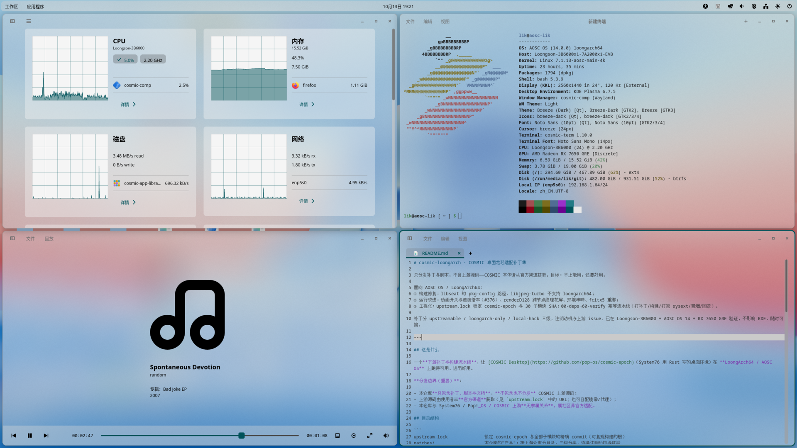

## §0 环境证据



上图为本机（Loongson-3B6000 / AOSC OS 14 / RX 7650 GRE）上 COSMIC 1.10.0 的实际运行画面：
亮色主题 + `frosted = High2` + 本仓库补丁 0001 的 `speed = 2.0`；
系统监视器、终端（fastfetch）、COSMIC Player 与 cosmic-edit 均正常。

# 测试与验收（TESTING）

上游 COSMIC 是**两周一个版本**的活跃项目，本仓库又是下游补丁集——所以测试必须**可重复、可记录**。
原则：**每次 rebase 上游或新增补丁，都跑一遍「自动冒烟 + 人工清单」，并把结果记进本文件的记录表。**

## 1. 自动冒烟

```bash
./tests/smoke.sh          # 只读检查，不改变系统状态
./scripts/60-verify.sh    # 同上，并写出 state/last-verify.txt
```

覆盖项：

| 检查 | 通过标准 |
|---|---|
| `upstream.lock` 与构建树一致 | 所有 pin 的 SHA 匹配 |
| 补丁全部应用 | `20-apply.sh --check` 无失败 |
| 产物存在且元数据正确 | `cosmic-sysext/usr/lib/extension-release.d/extension-release.cosmic-sysext` 的 `ID`/`VERSION_ID` 与本机匹配 |
| 关键二进制存在 | `cosmic-comp`、`cosmic-session`、`cosmic-panel`、`cosmic-settings`、`xdg-desktop-portal-cosmic` |
| 动态库无缺失 | 上述二进制的 `ldd` 输出中 `not found` 计数为 0 |
| 会话文件 | `usr/share/wayland-sessions/cosmic.desktop` 存在且 `Exec` 指向 `start-cosmic` |
| 扩展可被 systemd 接受 | `systemd-sysext --root=<临时根> list` 能识别 |
| 输入法协议 | `cosmic-comp` 二进制中包含 `zwp_input_method_manager_v2`（供 fcitx5 使用）|
| 已安装状态（可选）| `systemd-sysext status` 显示 `/usr ← cosmic-sysext` |

## 2. 人工验收清单

进入 COSMIC（登录管理器选择，或 TTY `start-cosmic`）后逐项确认。判定标准写死，避免"感觉还行"。

### 2.1 会话与合成器

- [ ] 桌面正常出现，无黑屏/花屏；面板、壁纸、光标渲染正常
- [ ] 窗口拖动/缩放流畅；自动平铺（Autotile）与窗口堆叠（Stack）可用
- [ ] 工作区切换、总览（Overview）可进入与退出
- [ ] 关闭/最小化/恢复窗口动画正常播放（若已应用动画补丁：`speed` 改动**热生效**）

### 2.2 桌面组件

- [ ] 面板：时间、状态区、音量、电池、网络、输入源 applet 均显示且可交互
- [ ] 通知：`notify-send test hello` 弹出通知
- [ ] 启动器：Super 键打开，可搜索并启动应用
- [ ] 设置：`cosmic-settings` 各页可打开、可修改并生效（主题、面板、快捷键、显示）
- [ ] 文件：`cosmic-files` 可浏览、复制、打开文件；无 applet 崩溃（对照 K-004）
- [ ] 终端：`cosmic-term` 可用；窗口大小调整时字体重绘正常

### 2.3 输入与语言

- [ ] Ctrl+Space 切换输入法；中文（RIME/雾凇拼音）可打词、候选窗可见
- [ ] 切换 VT 回到 KDE 再返回，输入法可用（必要时 `60-verify.sh --rebind-ime`）
- [ ] XWayland 应用（如旧版 Wine 程序）可正常输入

### 2.4 系统集成

- [ ] 音频：`cosmic-player` 或 `pactl` 播放有声；音量 applet 调节生效
- [ ] 网络：NetworkManager 状态正确，连接/断开反映到 applet
- [ ] 截图：`cosmic-screenshot` 或 PrintScreen 可用（依赖 `xdg-desktop-portal-cosmic`）
- [ ] 剪贴板：跨应用复制粘贴；Wayland ↔ XWayland 双向
- [ ] 电源/会话：注销、重启、关机动作可用；空闲后 `cosmic-idle` 生效（锁屏/熄屏策略按配置）

### 2.5 显示与硬件

- [ ] 多输出/热插拔：接第二块屏后能识别、可配置相对位置（本机单卡多口，用 `cosmic-randr list` 佐证）
- [ ] 分辨率/刷新率修改生效并持久化
- [ ]（若可达）挂起/唤醒后画面恢复，无花屏（对照 K-003）

### 2.6 性能与资源（对照 `docs/PERFORMANCE.md`）

- [ ] 空闲：CPU 占用与内存落在基线区间内
- [ ] 交互：拖动窗口/滚动终端无明显掉帧；`cosmic-files-applet` 无持续高 CPU
- [ ] 与 KDE 会话并存时，切换 VT 后回切不残留异常

## 3. 记录表（每次测试追加一行）

| 日期 | 上游 pin (cosmic-epoch) | 补丁集版本/哈希 | 平台 | 冒烟 | 人工清单通过率 | 崩溃记录 | 备注 |
|---|---|---|---|---|---|---|---|
| 2026-10-13 | `364341d` | 无补丁（基线） | AOSC 14 / 3B6000 / RX 7650 GRE | 通过 | 见 §2（基线）| 无新 core | 首次可用基线 |
| 2026-10-13 | `364341d` | `ed91f32`（含补丁 0001）| AOSC 14 / 3B6000 / RX 7650 GRE | 通过 | 动画项：**用户确认生效**；其余待跑 | 无新增（历史 11 次均为自动尝试遗留）| 补丁 0001 验证：`speed` 1.5→3.0→4.0 热重载生效、`enabled:false` 可关；同一 pid 未重启。注意 K-005（环境串味致 winit 后端误选）与「TTY 会话日志不进 journal，需 `2>&1 | tee` 或 RUST_LOG 显式开启」|

## 4. 回归流程（rebase 上游后必做）

```bash
./scripts/10-fetch.sh --update      # 增量拉取并切到新 pin（或人工修改 upstream.lock）
./scripts/20-apply.sh --check       # 补丁是否仍可应用（预期会有冲突）
./scripts/20-apply.sh               # 解冲突后应用
./scripts/30-build.sh && ./scripts/40-sysext.sh
./scripts/60-verify.sh --report     # 自动项
# 人工：按 §2 清单逐项勾选，并核对 §2.6 性能是否退化
# 最后：把结果追加到 §3 记录表，并在 docs/KNOWN-ISSUES.md 标注新发现
```

## 5. 判定"可以发布"的最低门槛

1. 自动冒烟全绿；
2. 人工清单中 **2.1 / 2.2 / 2.3** 全通过，**2.4 / 2.5** 允许有明确记录的已知缺口；
3. 无新增崩溃（`coredumpctl` 无新记录）；
4. 性能不劣于上一版基线超过 10%（否则需在 `PERFORMANCE.md` 说明原因）。
